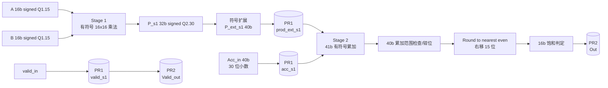

# 16 位有符号定点流水线乘加单元（MAC）微架构设计规格书

## 1. 设计范围与定点编码

本单元对每个有效输入事务执行一次乘加：

\[
S = \operatorname{Acc\_in} + \operatorname{sign\_extend}(A \times B)
\]
\[
\operatorname{Out} = \operatorname{SAT}_{16}\left(\operatorname{RNE}\left(\frac{S}{2^{15}}\right)\right)
\]

- `A`、`B` 为 16 位二进制补码有符号数，格式为 Q1.15，实数值为 `code / 2^15`。
- 乘积整数码为 `a × b`，宽度 32 位，格式为 Q2.30，低 30 位表示小数。
- `Acc_in` 与乘积使用相同的二进制小数点位置：40 位有符号数、30 位小数；其高 8 位相对于 32 位乘积为保护位，常用记法为 Q10.30。本文同时写明“40 位、30 位小数”，避免不同 Q 格式命名约定造成歧义。
- 输出为 16 位 Q1.15，正向饱和值为 `16'h7FFF`，负向饱和值为 `16'h8000`。
- 乘法、累加和舍入均采用二进制补码；所有涉及符号的运算必须显式声明为 signed。

## 2. 模块端口定义

| 信号名 | 方向 | 位宽 | 复位电平 | 描述 |
|---|---|---:|---|---|
| `clk` | input | 1 | N/A | 上升沿时钟。流水寄存器在 `posedge clk` 更新。 |
| `rst_n` | input | 1 | `0` 有效 | 低有效异步复位；复位有效时清零所有有效位和输出寄存器。 |
| `valid_in` | input | 1 | `0` | 输入事务有效脉冲。为 `1` 时，`A`、`B`、`Acc_in` 在该输入周期组成一笔事务。 |
| `A` | input | 16 | N/A | 有符号 Q1.15 操作数。 |
| `B` | input | 16 | N/A | 有符号 Q1.15 操作数。 |
| `Acc_in` | input | 40 | N/A | 有符号累加输入，30 位小数；与乘积二进制小数点对齐，含 8 位高位保护位。 |
| `Out` | output | 16 | `16'h0000` | 有符号 Q1.15 输出。仅在 `Valid_out=1` 时表示当前事务结果；无效周期保持上一次有效结果。 |
| `Valid_out` | output | 1 | `0` | 输出有效脉冲，与 `Out` 同周期对齐。 |

复位行为：`rst_n=0` 时，`prod_ext_s1`、`acc_s1`、`valid_s1`、`Out`、`Valid_out` 均清零；复位释放后按正常流水节拍运行。

## 3. 两级流水线规划

### 3.1 数据通路图

### 3.2 Stage 1：有符号乘法与符号扩展

Stage 1 在输入周期内完成以下组合运算，并在 Stage 1 末端写入 PR1：

1. 将 `A`、`B` 解释为 16 位二进制补码有符号整数 `a`、`b`。
2. 计算 32 位有符号乘积：
   \[
   P = a \times b \quad (P\text{ 为 Q2.30})
   \]
3. 进行 8 位符号扩展：
   \[
   P_{ext\_s1} = \{\{8\{P[31]\}\},P[31:0]\}
   \]
4. 同周期锁存 `Acc_in`，保证累加输入与乘积严格配对。
5. 将 `valid_in` 延迟到 `valid_s1`。

### 3.3 Stage 1 流水寄存器 PR1

| 字段 | 位宽 | 类型 | 复位值 | 作用 |
|---|---:|---|---|---|
| `prod_ext_s1` | 40 | signed | `40'h0` | 乘积符号扩展值，二进制小数点位于 bit30。 |
| `acc_s1` | 40 | signed | `40'h0` | 与该乘积配对的 `Acc_in`。 |
| `valid_s1` | 1 | logic | `1'b0` | PR1 数据有效标志。 |

`prod_ext_s1` 和 `acc_s1` 必须使用相同的 40 位 signed 属性；禁止将任一操作数先按 unsigned 扩展。

### 3.4 Stage 2：40 位累加、最近偶数舍入与饱和

Stage 2 从 PR1 读取数据，在 Stage 2 末端写入 PR2/输出寄存器：

1. 使用 41 位扩展执行有符号加法，防止 40 位加法发生环绕。
2. 对超出 40 位有符号范围的结果做防御性钳位；正常的 8 位 Guard Bits 设计下该分支通常不触发。
3. 对累加结果执行右移 15 位的最近偶数舍入（RNE）。
4. 将舍入后的整数码与 `[-32768, 32767]` 比较。
5. 正溢出钳位到 `16'h7FFF`，负溢出钳位到 `16'h8000`，否则取舍入结果低 16 位。
6. 将结果写入 `Out`，并将 `valid_s1` 写入 `Valid_out`。

### 3.5 Stage 2 输出寄存器 PR2

| 字段 | 位宽 | 类型 | 复位值 | 作用 |
|---|---:|---|---|---|
| `Out` / `out_s2` | 16 | logic | `16'h0000` | 饱和后的 Q1.15 输出码。 |
| `Valid_out` | 1 | logic | `1'b0` | 与 `Out` 对齐的有效标志。 |

当 `valid_s1=0` 时，`Valid_out` 清零，`Out` 保持上一次有效结果。连续有效输入时，单元支持每周期一笔事务，吞吐率为 1 transaction/cycle。

### 3.6 周期关系

按“输入事务在周期边界发射，Stage 1 和 Stage 2 各占一个完整周期”的口径定义：

| 周期 | Stage 1 | Stage 2 | 有效位 |
|---|---|---|---|
| `N` | 对 `A/B` 做乘法和符号扩展 | — | `valid_in(N)` |
| `N+1` | 接收下一笔输入 | 对 PR1 数据做累加、RNE、饱和 | `valid_s1(N+1)` |
| `N+2` | 接收下一笔输入 | 将本笔 Stage 2 结果写入 PR2 | `Valid_out(N+2)` |

因此固定流水延迟为 2 个周期：

\[
Valid\_out[N+2] = valid\_in[N]
\]

## 4. 溢出保护与 40 位累加公式

### 4.1 41 位加法

令 `prod_ext_s1`、`acc_s1` 为 40 位 signed：

\[
S_{41} = \{acc\_s1[39],acc\_s1\} + \{prod\_ext\_s1[39],prod\_ext\_s1\}
\]

其中 `S_41[40]` 为符号位。40 位有符号溢出判定为：

\[
ovf_{40} = S_{41}[40] \oplus S_{41}[39]
\]

具体钳位公式：

\[
S_{40} =
\begin{cases}
40'h7FFFFFFFFF, & S_{41}[40:39]=2'b01 \quad(正溢出) \\
40'h8000000000, & S_{41}[40:39]=2'b10 \quad(负溢出) \\
S_{41}[39:0], & \text{其他情况}
\end{cases}
\]

`S_40` 仍保持 30 位小数。40 位最大值和最小值分别为 `40'sh7FFFFFFFFF` 与 `40'sh8000000000`。

### 4.2 舍入位定义

对 `S_40` 做算术右移 15 位。为避免负数截断歧义，先定义算术右移结果：

\[
Q_{floor} = \operatorname{sign\_extend}_{41}(S_{40}) >>> 15
\]

取被丢弃的 15 位：

\[
F = S_{40}[14:0]
\]

逐位定义：

- Guard 位：`G = F[14]`，即保留位之后的第一位。
- Sticky 位：`St = |F[13:0]`，表示 Guard 位以下是否存在任意 `1`。
- 保留结果最低位：`L = Q_floor[0]`。由于是算术右移，`L` 等价于 `S_40[15]`。

最近偶数舍入增量为：

\[
inc = G \land (St \lor L)
\]

等价逐位写法：

\[
inc = S_{40}[14] \land \left(\left|S_{40}[13:0]\right| \lor S_{40}[15]\right)
\]

舍入结果为：

\[
Q_{round} = Q_{floor} + inc
\]

`Q_floor` 和 `Q_round` 建议使用 41 位 signed 保存，以覆盖最大正值舍入时的进位。

### 4.3 最近偶数舍入判定表

| `G` | `St` | `L` | 含义 | `inc` |
|---:|---:|---:|---|---:|
| 0 | X | X | 小于半 LSB | 0 |
| 1 | 1 | X | 大于半 LSB | 1 |
| 1 | 0 | 0 | 恰好半 LSB，当前结果为偶数 | 0 |
| 1 | 0 | 1 | 恰好半 LSB，当前结果为奇数 | 1 |

这里对负数同样成立，因为算术右移得到的是向负无穷取整的 `Q_floor`，`inc=1` 会在需要时将结果向零方向调整：

- `-0.5 LSB` 舍入为 `0`；
- `-1.5 LSB` 舍入为 `-2`；
- 恰好处于中点时，最终整数码的最低位为 `0`。

## 5. 逐位饱和判定

`Q_round` 为 41 位 signed 整数码，合法输出码范围为 `-32768` 至 `+32767`。先舍入、后饱和，避免 `+32767.5` 等边界被错误截断。

位级溢出条件为：

\[
pos\_ovf = \lnot Q_{round}[40] \land \left|Q_{round}[39:15]\right|
\]
\[
neg\_ovf = Q_{round}[40] \land \lnot\left(\&Q_{round}[39:15]\right)
\]

解释：

- 合法正数 `0..32767` 的 `Q_round[40:15]` 全为 `0`；只要正数的 `[39:15]` 出现 `1`，即大于 `32767`。
- 合法负数 `-32768..-1` 的 `Q_round[40:15]` 全为 `1`；只要负数的 `[39:15]` 不全为 `1`，即小于 `-32768`。

输出选择逻辑：

\[
Out =
\begin{cases}
16'h7FFF, & pos\_ovf=1 \\
16'h8000, & neg\_ovf=1 \\
Q_{round}[15:0], & \text{其他情况}
\end{cases}
\]

等价的有符号比较形式为：

\[
Out =
\begin{cases}
16'h7FFF, & Q_{round} > 41'sd32767 \\
16'h8000, & Q_{round} < -41'sd32768 \\
Q_{round}[15:0], & \text{其他情况}
\end{cases}
\]

## 6. 边界行为与实现约束

- `A=16'h8000`、`B=16'h8000` 时，32 位乘积为正 `2^30`，不会在 Stage 1 溢出。
- `Acc_in`、乘积和 41 位扩展加法必须保持同一二进制小数点位置；禁止在累加前右移乘积。
- 饱和必须发生在 RNE 之后；例如舍入得到 `32768` 时输出 `16'h7FFF`。
- `Valid_out` 必须与 `Out` 使用同一条两级有效位路径；禁止直接组合旁路 `valid_in`。
- 复位释放后首笔有效事务按完整两级流水延迟输出；复位期间不得产生 `Valid_out=1`。
- 40 位累加范围钳位是防御性逻辑；8 位 Guard Bits 的目标是在系统规定的累加长度和输入范围内避免该分支被触发。
- 边界示例：`A=B=16'h8000` 时乘积为 `+1.0` 的 Q2.30 码，缩放后为 `32768`，最终输出钳位为 `16'h7FFF`；负向超出 `-32768` 的结果钳位为 `16'h8000`。
