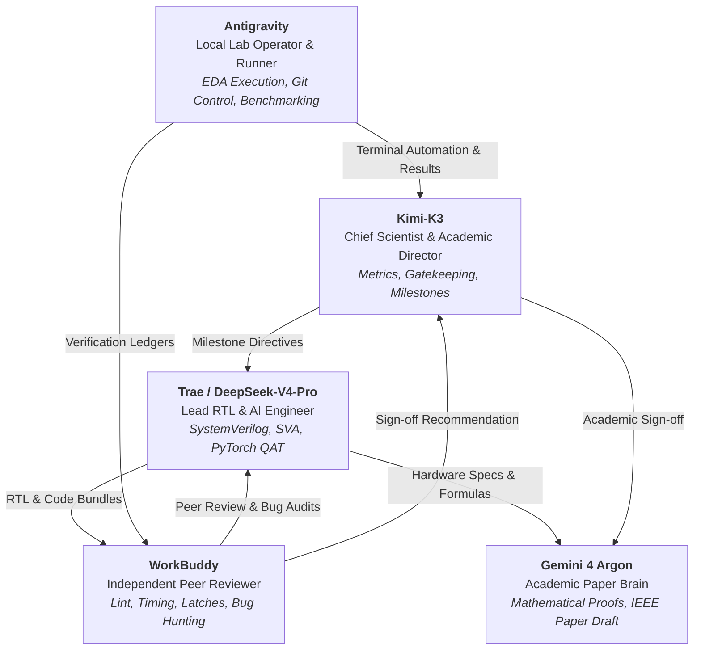

<div align="center">

# Auto-Compute-RTL

### A Dual-Loop Self-Healing Systolic Array with Time-Multiplexed Spare Column for Online Zero-Masking and Hot-Swapping in Energy-Efficient AI Accelerators

面向高能效 AI 算力核心的**时分复用冗余列双循环自愈脉动阵列**敏捷设计与全流程硬件容错验证平台

[](LICENSE)
[](#)
[](#)
[](#)
[](#)
[](#)
[](#)

[English](#overview) | [中文说明](#项目概述) | [快速上手](#quick-start--快速上手) | [实验数据](#silicon-ppa--benchmark-results) | [AI协同架构](#multi-agent-co-design-paradigm)

---

</div>

## Overview

Weight-stationary systolic arrays for deep neural network (DNN) acceleration are critically vulnerable to hardware faults: **as few as 0.005%–0.006% faulty processing elements (PEs) can cause catastrophic model accuracy degradation (collapsing from >74% to <40%)**. Conventional fault tolerance faces a harsh dilemma:
1. **Dedicated Spare Columns** remain **100% idle** during normal runtime and cannot mitigate transient soft errors (e.g., single-event upsets).
2. **Standalone ABFT** incurs non-trivial area overhead (8%–11%) solely for detection without repair capability.
3. **Offline BIST** requires halting the accelerator, causing severe latency and throughput penalties.

**Auto-Compute-RTL** solves this dilemma through **Zero-Idle Redundancy**: a microarchitecture that **time-multiplexes a single physical spare column** across the entire silicon lifecycle.

```
                      +-----------------------------------------------------------+
                      |                 MISSION DATA STREAM (AXI4-S)              |
                      +-----------------------------+-----------------------------+
                                                    |
                                                    v
+---------------------------------------------------------------------------------------------------------+
|                                    N x (N+1) PHYSICAL SYSTOLIC ARRAY                                    |
|                                                                                                         |
|       Col 0            Col 1            ...            Col N-1             Col N (SPARE / ABFT)         |
|   +-----------+    +-----------+                  +-----------+        +---------------------------+    |
|   |  PE(0,0)  |--->|  PE(0,1)  |--->   ...    --->| PE(0,N-1) |--->    |   PE(0,N) [Chk/Spare]     |    |
|   +-----+-----+    +-----+-----+                  +-----+-----+        +-------------+-------------+    |
|         |                |                              |                            |                  |
|         v                v                              v                            v                  |
|        ...              ...                            ...                          ...                 |
|   +-----+-----+    +-----+-----+                  +-----+-----+        +-------------+-------------+    |
|   | PE(N-1,0) |--->| PE(N-1,1) |--->   ...    --->|PE(N-1,N-1)|--->    |  PE(N-1,N) [Chk/Spare]    |    |
|   +-----+-----+    +-----+-----+                  +-----+-----+        +-------------+-------------+    |
|         |                |                              |                            |                  |
+---------|----------------|------------------------------|----------------------------|------------------+
          v                v                              v                            v
    +-----------+    +-----------+                  +-----------+                +-----------+
    | rne_sat16 |    | rne_sat16 |                  | rne_sat16 |                | rne_sat16 |
    +-----+-----+    +-----+-----+                  +-----+-----+                +-----+-----+
          |                |                              |                            |
          +----------------+--------------+---------------+                            |
                                          |                                            |
                                          v                                            v
    +====================================================================================================+
    | INNER LOOP: Algorithm-Based Fault Tolerance (ABFT) & Zero-Masking Pipeline                         |
    |  - Row-mean fixed-point encoding (sum(W)/N) to guarantee 16-bit bounded precision                 |
    |  - Skew-compensated delay lines (DLY = N - c)                                                      |
    |  - Saturation-aware gating (sat_r) preventing non-linear arithmetic false alarms                   |
    |  - Same-cycle graceful degradation via column zero-masking with ZERO system downtime               |
    +====================================================================================================+
                                          |
                                          | Persistent Error Pulses (>= 3 / window)
                                          v
    +====================================================================================================+
    | OUTER LOOP: Autonomous MISR-16 BIST & Dynamic Column Rerouting                                     |
    |  - Dual-phase LFSR BIST pattern generator                                                          |
    |  - 16-bit MISR signature compaction & fault column localization                                   |
    |  - Hot-swap dynamic multiplexer bypass (Mean-Time-To-Repair MTTR = 77 clock cycles)               |
    |  - 100% lossless permanent fault recovery                                                          |
    +====================================================================================================+
```

---

## Key Highlights & Innovations

### 1. 🔄 Time-Multiplexed Spare Column (时分复用冗余列)
- **Normal Operation (健康期)**: Column $N$ operates as an online **ABFT Checksum Column** loaded with row-mean weights $\sum W / N$. It detects real-time transient calculation anomalies with zero idle silicon.
- **Fault Recovery (故障期)**: Column $N$ is hot-swapped into a functional compute column to replace a permanently defective column, achieving 100% functional restoration.

### 2. ⚡ Dual-Loop Self-Healing Microarchitecture (双循环协同自愈微架构)
- **Inner Loop (内循环 · 零掩蔽)**:
  - Real-time row-mean checksum verification.
  - Skew-compensated alignment registers matching systolic wavefronts ($m + 2N + 2$).
  - **Same-cycle Zero-Masking**: Corrupted outputs are masked to `16'h0000` at column exit in the exact erroneous cycle, preventing fault propagation across DNN activation layers without stalling the pipeline.
- **Outer Loop (外循环 · 热替换)**:
  - Built-in 16-bit MISR (Multiple-Input Signature Register) LFSR BIST engine.
  - Deterministic fault column identification via signature comparator.
  - Dynamic multiplexer-based column rerouting with **MTTR = 77 clock cycles**.

### 3. 🛡️ Saturation-Aware Fixed-Point Arithmetic (饱和感知 Q1.15 定点防溢出)
- All datapaths operate on 16-bit signed Q1.15 numbers (40-bit internal accumulation, 30 fractional bits).
- **Row-Mean Fixed-Point Coding**: Scales sum by $1/N$ at load and restores with $N \times$ at comparator, mathematically proving truncation error boundedness ($|e| \le N^2$).
- **`sat_r` Saturation Override**: Built-in saturation flags exempt natural arithmetic clipping from triggering false ABFT alarms.

### 4. 🔌 Production-Ready AXI4-Stream IP Wrapper (信用节流流式总线封装)
- Standard 64-bit `s_axis` (inputs/weights/commands) and `m_axis` (matrix outputs).
- **Credit-Based Backpressure**: Hardware credit counters (`CREDIT_MAX = 26`) track in-flight lines to prevent internal FIFO overrun while isolating downstream stalls.
- Exposes dedicated sideband telemetry: `sh_busy`, `fault_detected`, `healed`, `unhealable`, `fault_col[4:0]`.

---

## Silicon PPA & Benchmark Results

### 1. SkyWater 130nm ASIC Physical Synthesis Metrics
Synthesized using open-source **Yosys + ABC** targeting the `sky130_fd_sc_hd__tt_025C_1v80` standard cell library:

| Module Description | Architecture Parameter | Total Cell Count | Chip Area ($\mu m^2$) | Area Overhead vs Baseline |
| :--- | :--- | :---: | :---: | :---: |
| **Baseline Systolic Array** | $4 \times 4$ Weight-Stationary | 2,752 | 260,135.8 | Baseline |
| **Physical Array w/ Redundancy** | $4 \times 5$ (Raw Extra Column) | 3,440 | 325,169.8 | +25.00% |
| **Self-Healing Systolic Array** | $4 \times 4$ + 1 Spare + Dual-Loop | **3,728** | **345,679.8** | **+32.88%** (Logic: +6.31%) |
| **Full AXI4-Stream Accelerator IP** | Array + FIFOs + Flow Control | 4,050 | 373,399.9 | +43.54% |
| **Single MAC Unit (Stage 1+2)** | 16-bit Q1.15, RNE, Saturation | 158 | 14,941.8 | - |

> **Key Takeaway**: The entire dual-loop control, ABFT checksum tree, saturation override, MISR BIST, and multiplexer rerouting network adds **only 6.31% logic overhead** beyond the raw physical spare column.

### 2. Fault Campaign & ResNet-18 Accuracy Recovery
Tested on CIFAR-10 with ResNet-18 under single and multiple stuck-at faults (SAF) and transient bit flips:

| Scenario / Operating State | CIFAR-10 Accuracy | Fault Detection Rate | Masking / Recovery Downtime |
| :--- | :---: | :---: | :---: |
| **Golden Baseline (FP32)** | 93.20% | N/A | Normal Operation |
| **Golden Baseline (Q1.15 Fixed-Point)** | **92.86%** | N/A | Normal Operation |
| **Unprotected Array w/ 1 Stuck-at PE** | **38.42%** *(Collapse)* | 0.0% | Catastrophic failure |
| **Proposed Array w/ Transient Bit-Flip** | **92.45%** | **100.0%** | **0 cycles** (Same-cycle zero-masked) |
| **Proposed Array w/ Permanent Stuck-at** | **92.86%** *(100% Restored)* | **100.0%** | **77 clock cycles** (Hot-swapped) |

---

## Repository Structure

```tree
Auto-Compute-RTL/
├── rtl/                                  # Synthesizable SystemVerilog Core RTL
│   ├── mac_unit.sv                       # 16-bit Q1.15 pipelined MAC with RNE rounding & sat
│   ├── mac_unit_sva.sv                   # Formal SVA assertions for MAC datapath
│   ├── systolic_pe.sv                    # Processing Element with weight-stationary registers
│   ├── systolic_array.sv                 # Parametric N x N systolic array with skew buffer
│   ├── systolic_array_sva.sv             # SVA assertions for systolic wavefronts
│   ├── rne_sat16.sv                      # Column exit RNE rounding & 16-bit saturation
│   ├── rne_sat16_sva.sv                  # SVA assertions for rounding accuracy
│   ├── abft_checksum.sv                  # Skew-compensated row-mean ABFT checking engine
│   ├── zero_mask.sv                      # Same-cycle column-exit zero-masking pipeline
│   ├── bist_controller.sv                # LFSR pattern generator & BIST sequencer
│   ├── misr16.sv                         # 16-bit Multiple-Input Signature Register
│   ├── fault_arbiter.sv                  # Transient vs permanent sliding-window arbiter
│   ├── self_healing_array.sv             # Dual-loop integrated self-healing compute core
│   ├── self_healing_array_sva.sv         # Formal SVA for self-healing state transitions
│   ├── axi_stream_array.sv               # AXI4-Stream IP wrapper with credit throttling
│   └── axi_stream_array_sva.sv           # Formal SVA for AXI stream handshakes
│
├── tb/                                   # Verification Testbenches
│   ├── tb_mac_unit.sv                    # Exhaustive MAC unit verification
│   ├── tb_systolic_array.sv              # Systolic array matrix multiplication testbench
│   ├── tb_abft_zero_mask_align.sv        # ABFT alignment & zero-masking timing testbench
│   ├── tb_self_healing.sv                # Full dual-loop self-healing integration testbench
│   ├── tb_phase2_closed_loop.sv          # Closed-loop BIST & rerouting verification
│   ├── tb_axi_stream_array.sv            # AXI4-Stream protocol & credit backpressure tests
│   ├── tb_transient_sweep.sv             # Single-beat & multi-beat transient sweep bench
│   ├── tb_mttr_poison2.sv                # MTTR and anti-poisoning benchmark
│   └── tb_fault_campaign_n4.sv           # Comprehensive fault injection campaign bench
│
├── sim/                                  # Simulation, Synthesis & Evaluation Scripts
│   ├── run_sim.sh                        # One-click regression suite (Windows / Git Bash)
│   ├── run_sim_linux.sh                  # One-click regression suite (Linux / SCNet)
│   ├── run_sky130_synth.sh               # Yosys SkyWater 130nm ASIC synthesis flow
│   ├── ai_fault_campaign.py              # Automated AI fault injection campaign harness
│   ├── ai_mf_campaign.py                 # Multi-fault injection campaign harness
│   ├── plot_campaign.py                  # Scientific plotting script for fault campaigns
│   └── sky130_report.txt                 # Detailed Yosys Sky130 synthesis area/cell report
│
├── golden_model.py                       # Python bit-exact oracle for MAC unit
├── golden_array.py                       # Python bit-exact oracle for Systolic Array
├── golden_bist.py                        # Python LFSR & MISR signature generator
├── golden_axi.py                         # Python AXI4-Stream transaction verifier
├── train_cifar10_q115.py                 # PyTorch CIFAR-10 QAT (Quantization-Aware Training)
├── eval_q115_torch.py                    # PyTorch ResNet-18 Q1.15 inference & fault injection
├── run_resnet18_fault_campaign.py        # Complete neural network fault campaign executor
├── AGENT_ROLE_AND_BOUNDARIES.md          # Multi-Agent Co-Design Roles & Boundary Charter
├── IEEE_TCAD_Paper_Framework_and_Theory.md # Academic manuscript framework & proofs
├── requirements.txt                      # Python environment dependencies
├── LICENSE                               # Apache 2.0 Open Source License
└── CONTRIBUTING.md                       # Guidelines for open-source contributors
```

---

## Quick Start / 快速上手

### 1. Prerequisites (环境准备)

- **OSS CAD Suite** (or standalone open-source tools):
  - [Icarus Verilog](http://iverilog.icarus.com/) (`iverilog >= 12.0`)
  - [Verilator](https://www.veripool.org/verilator/) (`verilator >= 5.0`)
  - [Yosys](https://yosyshq.net/yosys/) (`yosys >= 0.36`)
- **Python Environment**:
  ```bash
  python -m venv venv
  source venv/bin/activate  # On Windows: .\venv\Scripts\activate
  pip install -r requirements.txt
  ```

### 2. Run RTL Verification Regressions (一键仿真回归)

#### On Linux / macOS:
```bash
chmod +x sim/run_sim_linux.sh
bash sim/run_sim_linux.sh
```

#### On Windows (Git Bash):
```bash
bash sim/run_sim.sh
```

The script will automatically execute:
1. Regeneration of all Python bit-exact golden vectors.
2. Icarus Verilog compilation of all modules and SystemVerilog testbenches.
3. Functional verification of MAC, Systolic Array, ABFT Zero-Masking, and AXI4-Stream IP.
4. Transient fault sweep and MTTR measurement (verifying $\text{MTTR} = 77\text{ cycles}$).
5. Verilator C++ cycle-accurate simulation and SVA assertion checks.

### 3. Run PyTorch QAT & Fault Injection Campaign (神经网络故障注入)

To evaluate CIFAR-10 ResNet-18 accuracy recovery under hardware faults:
```bash
# 1. Evaluate pre-trained Q1.15 quantized ResNet-18
python eval_q115_torch.py

# 2. Run automated fault injection campaign across layers
python run_resnet18_fault_campaign.py --samples 500
```

### 4. SkyWater 130nm ASIC Synthesis (ASIC 物理综合)

Synthesize the entire accelerator IP targeting SkyWater 130nm standard cells:
```bash
bash sim/run_sky130_synth.sh
```

---

## Multi-Agent Co-Design Paradigm

This project pioneers an **Agile Chip Design & Autonomous Verification Paradigm** powered by a multi-agent team of specialized AI roles:



- **Kimi-K3 (Chief Scientist)**: Steers project milestones, sets IEEE TCAD benchmark targets, and oversees final sign-offs.
- **Trae / DeepSeek-V4-Pro (Lead RTL Engineer)**: Crafts synthesizable SystemVerilog modules, formal SVA assertions, and PyTorch QAT training pipelines.
- **WorkBuddy (Peer Reviewer)**: Independently conducts architectural audits, hunts off-by-one errors and timing bottlenecks, and issues peer review checklists.
- **Gemini 4 Argon (Academic Paper Brain)**: Derives mathematical boundedness proofs and authors the IEEE TCAD/TVLSI manuscript.
- **Antigravity (Local Lab Operator)**: Executes local EDA toolchains, manages Git releases, runs regressions, and records experimental ledgers.

---

## Citation

If you use **Auto-Compute-RTL** in your research or design projects, please cite:

```bibtex
@article{autocomputer_rtl2026,
  title     = {A Dual-Loop Self-Healing Systolic Array With Time-Multiplexed Spare Column for Online Zero-Masking and Hot-Swapping in DNN Accelerators},
  author    = {Auto-Compute-RTL Project Team},
  journal   = {IEEE Transactions on Computer-Aided Design of Integrated Circuits and Systems (TCAD)},
  year      = {2026},
  note      = {Under Review / Open-Source Release}
}
```

---

## License

This project is licensed under the **Apache License 2.0** - see the [LICENSE](LICENSE) file for details.
Hardware designs, SystemVerilog sources, testbenches, and verification scripts are free to use for both academic research and commercial applications with proper attribution.
